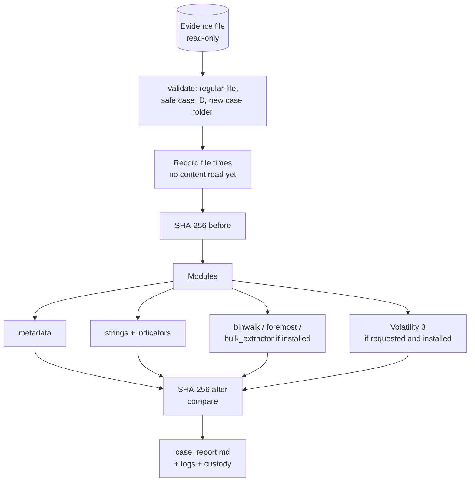
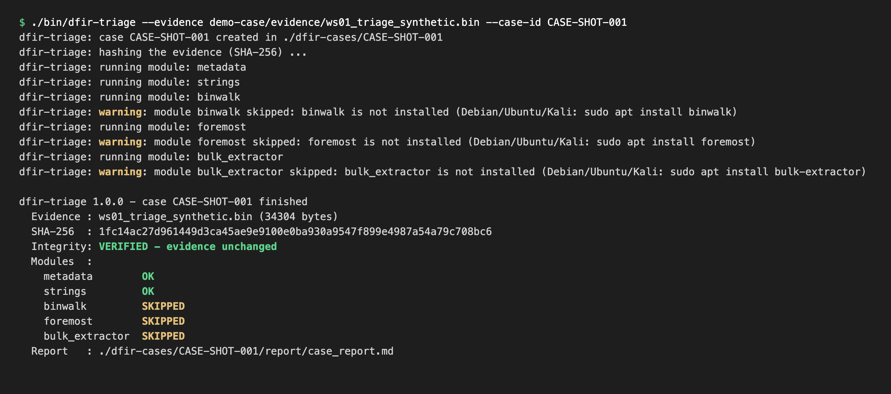
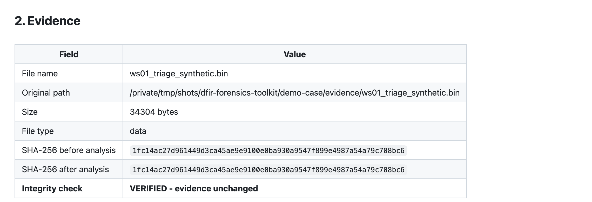
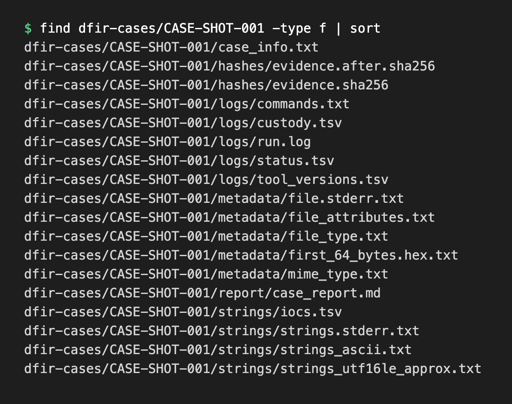
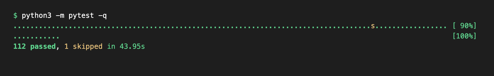

# DFIR Forensics Triage Toolkit (`dfir-triage`)

[](https://github.com/OYDeadpoolife/dfir-forensics-toolkit/actions/workflows/ci.yml)

`dfir-triage` is a Bash tool for the **first hour of a digital-forensics investigation**. You give it one authorised
evidence file; it proves the file is not changed (SHA-256 before and after), records metadata and file times, extracts
strings and indicators (IP addresses, URLs, e-mail addresses), optionally runs `binwalk`, `foremost`, `bulk_extractor`
and Volatility 3 when they are installed, and writes everything into a new case folder with a readable Markdown report.

> **Status:** Version 1.0.0. The built-in modules and the orchestration are tested (see [TEST_RESULTS.md](TEST_RESULTS.md)).
> **The integration with the real `binwalk`, `foremost`, `bulk_extractor` and Volatility has NOT been verified**: those
> programs were not installed where this was built; they are tested only with stub programs. The demo evidence is
> synthetic and harmless. This is a learning and portfolio project, not a certified forensic tool.

## For a recruiter or SOC manager (30 seconds)

* **Problem:** a first-responder gets a disk or memory image and must preserve it, describe it and find leads quickly,
  without altering it and while keeping notes a colleague can verify.
* **What this does:** automates the repeatable, *read-only* part: hashing, metadata, strings and indicators, optional
  carving and memory analysis, an execution log with timestamps and tool versions, and a case report.
* **What it shows about the author:** forensic discipline (hash before and after, chain-of-custody log, UTC time),
  safe Bash (no root, no auto-install, no overwriting, time limits), automated testing, and honesty about what is verified.
* **Where it fits:** step 4 of a four-project defensive workflow
  (network events → SOC detection → automated log analysis → **DFIR investigation**). It works on its own.

## Main objectives

1. Accept a user-provided, authorised evidence file and **never modify it**.
2. Prove integrity with SHA-256 before and after, and record a chain-of-custody log.
3. Collect metadata, strings and indicators; run optional tools safely and record their outcome.
4. Handle missing programs gracefully (report, never install) and long-running tools (time limit).
5. Produce a case folder and a report that another analyst can follow and verify.

## Technologies

Bash 3.2+ (macOS and Linux), standard Unix tools (`file`, `strings`, `sha256sum`/`shasum`, `od`, `grep`, `awk`),
optional `binwalk`, `foremost`, `bulk_extractor`, Volatility 3; Python 3 + pytest for the tests and to rebuild the demo
evidence; ShellCheck, shfmt, GitHub Actions.

## Features

| Area | What you get |
|---|---|
| Evidence handling | Read-only access, SHA-256 before/after, integrity verdict, optional verified read-only working copy (`--copy-evidence`), optional MD5 |
| Metadata | File type, MIME type, first 64 bytes, size, file times recorded **before** the content is read |
| Strings | ASCII and approximate UTF-16LE strings, indicator extraction (valid IPv4, URLs, e-mails), size limit for huge files |
| External tools | `binwalk`, `foremost`, `bulk_extractor`, Volatility 3 (named plugins), each with time limit, captured output and recorded status |
| Safety | No `sudo`, no installs, no network, existing cases never overwritten, case IDs validated, private permissions |
| Records | `status.tsv`, `commands.txt` (exact commands), `tool_versions.tsv`, `custody.tsv`, `run.log`, `case_report.md` |
| Testing aids | `--dry-run`, `--list-modules` |

## How it works



See [docs/forensics-workflow.md](docs/forensics-workflow.md).

## Requirements

* Bash 3.2 or newer, and the standard tools listed above (present on default macOS, Ubuntu, Debian and Kali).
* Optional, only for the modules you want: `binwalk`, `foremost`, `bulk_extractor`, Volatility 3.
  `dfir-triage` **never installs anything**; if a program is missing the module is recorded as `SKIPPED` with an install hint.
* No root privileges. Run it as an ordinary user.

## Quick start

```bash
git clone https://github.com/OYDeadpoolife/dfir-forensics-toolkit.git
cd dfir-forensics-toolkit
./bin/dfir-triage --list-modules                     # what can run on this machine
./bin/dfir-triage --evidence demo-case/evidence/ws01_triage_synthetic.bin --case-id CASE-DEMO-001
```

The case folder is created under `./dfir-cases/CASE-DEMO-001/`.

## Usage

```bash
# Check the plan first: creates and writes nothing
./bin/dfir-triage --evidence image.raw --dry-run

# A real case with analyst name and a verified read-only working copy
./bin/dfir-triage -e image.raw -c CASE-2026-014 -a "Your Name" --copy-evidence

# Memory image: Volatility 3 plugins (needs Volatility 3 and, for Windows, internet access for symbol tables)
./bin/dfir-triage -e memory.raw -c CASE-2026-015 --modules metadata,strings,volatility

# Huge image: limit the strings scan and give each tool 10 minutes
./bin/dfir-triage -e disk.dd --strings-limit-mb 512 --timeout 600
```

All options, exit codes and the case folder layout: [docs/usage.md](docs/usage.md).

## Expected output

```text
dfir-triage 1.0.0 - case CASE-DEMO-001 finished
  Evidence : ws01_triage_synthetic.bin (34304 bytes)
  SHA-256  : 1fc14ac27d961449d3ca45ae9e9100e0ba930a9547f899e4987a54a79c708bc6
  Integrity: VERIFIED - evidence unchanged
  Modules  :
    metadata        OK
    strings         OK
    binwalk         SKIPPED
    foremost        SKIPPED
    bulk_extractor  SKIPPED
  Report   : cases/CASE-DEMO-001/report/case_report.md
```

This is real output from the author's macOS machine, where `binwalk`, `foremost` and `bulk_extractor` were not installed, which is
why they are `SKIPPED`. The complete case folder of that run is in
[demo-case/example-run/CASE-DEMO-001/](demo-case/example-run/CASE-DEMO-001/) (the local account name was redacted from the file owner field).

## The demo case

[demo-case/](demo-case/) contains one fictional incident ("Harbor Lab", workstation WS01) with harmless synthetic evidence,
a case summary, evidence inventory, investigation questions, commands with expected output, analyst notes, a timeline,
findings, limitations and a final incident report. Every step says whether it was **executed here** or **still needs
verification with the real tool**.

## Screenshots

Real screenshots are added by the author after running the project. Planned shots and exact commands are in
[screenshots/README.md](screenshots/README.md). Until they exist, no image is embedded here.

<!--




-->

## Testing

```bash
python3 -m venv .venv && . .venv/bin/activate
pip install -r requirements-dev.txt
python3 -m pytest -v       # 113 tests
make lint                  # ShellCheck + shfmt
```

The suite covers normal, empty, malformed and hostile inputs, paths with spaces and Hebrew characters, a tool that
modifies the evidence, a tool that fails, a tool that hangs, and the privacy of the repository. External programs are
imitated by stubs, so the suite proves the toolkit's behaviour, not the behaviour of the real tools. Details and gaps:
[TEST_RESULTS.md](TEST_RESULTS.md).

## Limitations

* Triage, not a full investigation: it does not parse file systems, registries or event logs, and does not build a super-timeline.
* The real `binwalk`, `foremost`, `bulk_extractor` and Volatility integrations are unverified until you run them (see
  [docs/tool-integration.md](docs/tool-integration.md) for the exact manual steps).
* Volatility 3 only (not Volatility 2); Windows memory analysis normally needs internet access to fetch symbol tables.
* The demo evidence is a small synthetic blob, not a real disk or memory image. Do not present the demo as a real case.
* The time limit stops the program the toolkit starts, not any child processes it creates.
* Not suitable as-is for legal proceedings: it does not replace accredited tools, write blockers or your organisation's procedures.

## Future improvements

* Parse Windows artefacts (EVTX, Prefetch, Registry hives) with dedicated modules.
* Support E01/AFF image formats and a super-timeline.
* A machine-readable `case.json` next to the Markdown report.

## Origin and verification

The idea began as a small course script ("Windows Forensics", 2025) that checked for tools and asked for a file name.
This repository is a clean redesign built around forensic safety rules; no code from that script was reused.
Test results here are real runs on the environment listed in [TEST_RESULTS.md](TEST_RESULTS.md).

## Author

**Orhay Yosef** — aspiring SOC / SIEM analyst. GitHub: [OYDeadpoolife](https://github.com/OYDeadpoolife)
· Repository: <https://github.com/OYDeadpoolife/dfir-forensics-toolkit>
· License: [MIT](LICENSE)
